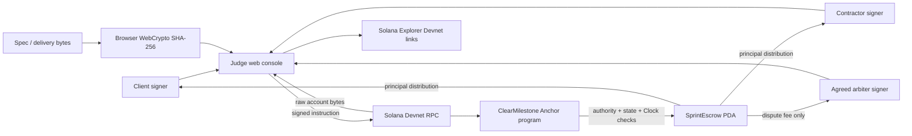
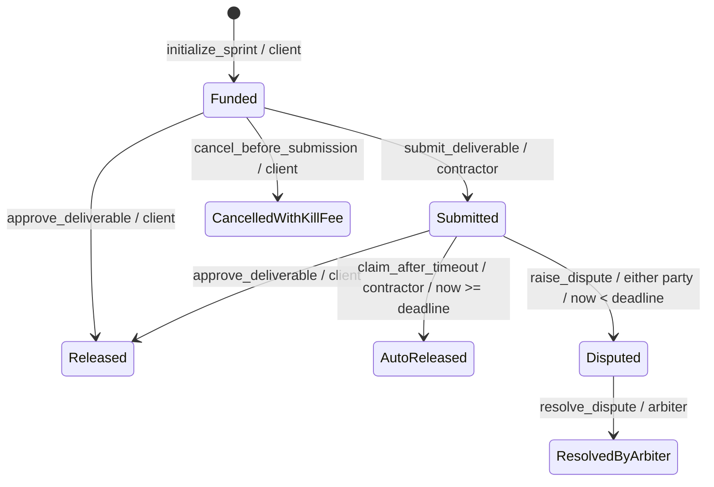

# ClearMilestone · BezPośrednika

**Fixed-scope work. Funded upfront. Clear exits.**

A Solana sprint escrow for the **HackYeah — Superteam Poland Track**:
*Replace a Web2 Intermediary with Solana*.

## Delivery status

This checkout contains a single-file Anchor program, a dependency-free verifier using the
program's actual transition rules, and a no-build judge console in `app/`.
The frontend was implemented locally by Codex with explicit user authorization, without SSH
or an external Claude CLI. See [frontend handoff](docs/frontend-handoff.md) for the wire contract
and [frontend verification](docs/frontend-verification.md) for test scope and limitations.

Verification on 2026-10-19:

| Check | Result |
| --- | --- |
| Pure Rust state-machine verifier | **11 passed, 0 failed** |
| Full Anchor/native program tests | Blocked: no cached anchor-lang; crates.io DNS unavailable |
| Rust formatting tool | Unavailable in both installed toolchains |
| Solana Playground SBF compilation | Unverified: build endpoint unreachable from local environment |
| Devnet deployment / transaction flows | Not performed; no deployed program ID supplied |
| Frontend static / wire checks | Passed; Python + Node vectors and compiled Rust rule oracle |
| Browser / wallet-extension verification | Blocked by local browser/port restrictions; optional smoke script provided |

All changes remain uncommitted. No deployment, paid operation, or live-funds transaction
has been performed. The program ID in source and Anchor.toml is a **placeholder**, not a
verified Devnet deployment.

## Who this is for

Independent Polish/EU **Programista B2B / Kontraktor**, software engineers and indie game
studios delivering a fixed-scope sprint for a foreign client. Think a Warsaw contractor
shipping an integration sprint or a small Kraków studio delivering a playable milestone.

The relationship is direct: client and contractor agree on scope, price, cancellation fee,
review period and an independent arbiter **before funding**. The client locks native SOL in
a program-owned PDA. The contractor commits a SHA-256 digest of the delivery. A platform
operator cannot hold acceptance or payout behind a support ticket.

The replaced intermediary is the **escrow and acceptance layer** of freelance platforms
such as Upwork, Fiverr and Escrow.com, not their discovery, reputation or tax services.
The brief's 10–20% fees and 5–14 day holds are motivating scenarios, not verified universal
or current terms for those named services. ClearMilestone takes **0% platform commission**;
network fees, account rent and a dispute-only arbiter fee remain.

## What changes

| Relationship | ClearMilestone mechanism |
| --- | --- |
| Trust the platform to hold the budget | A program-owned PDA holds the full principal |
| Argue over which scope was agreed | Store the agreed specification's SHA-256 commitment |
| Ask support to identify the delivered version | Commit deliverable hash and a short retrieval URI |
| Negotiate compensation after an early cancellation | Pre-agreed kill fee, capped at 50%, paid atomically |
| Wait indefinitely for a silent client | Contractor can claim after the on-chain review deadline |
| Pay an unbounded dispute charge | Named arbiter distributes funds; fee capped at 5% |

The chain verifies authority, time and accounting. A hash proves commitment to bytes;
it does not prove quality, legal ownership, or that the client can retrieve a file. Quality
disputes remain a human judgment by the agreed arbiter. Naming an arbiter does not itself
prove neutrality or establish an arbitration service agreement.

## Architecture



There is no custodial backend, platform fee recipient, oracle, cron worker, or private
administrator settlement route. The deployer's upgrade authority is a separate trust
consideration: this prototype does not claim immutable deployment. No production audit
has been performed.

Solana provides signed transactions, program-owned custody and atomic state/payment
updates. **Timeout release is permissionless with respect to client approval, but still
requires the contractor to submit `claim_after_timeout`.** It is not automatically scheduled.
No fixed 400ms confirmation or dollar-denominated fee is promised; latency, congestion,
priority fees and SOL exchange rates vary. The malformed `~zsh.0002` from the brief is not
used as a financial estimate.

## On-chain state machine



| Status byte | Name | Meaning |
| --- | --- | --- |
| 0 | Funded | Principal held; delivery not yet submitted |
| 1 | Submitted | Review window started |
| 2 | Released | Client voluntarily paid contractor |
| 3 | AutoReleased | Contractor claimed after timeout |
| 4 | CancelledWithKillFee | Client cancelled before submission |
| 5 | Disputed | Release frozen until arbiter resolution |
| 6 | ResolvedByArbiter | Principal distributed, including bounded fee |

Final states reject further transitions and payouts. A dispute prevents approval and
expiry claims even after the original deadline. There is no arbitrator-inactivity timeout
in this specification; funds can remain disputed indefinitely if that signer disappears.

### Instruction behavior

- `initialize_sprint(sprint_id, amount_lamports, kill_fee_bps, arbiter_fee_bps,
  review_window_secs, spec_hash)`: client signs and pays rent plus principal; principal
  enters the PDA through a System Program transfer. Amount > 0, kill fee ≤ 5000 bps,
  arbiter fee ≤ 500 bps, review period 0–2,592,000 seconds. The escrow PDA and all three party keys must differ.
- `submit_deliverable(deliverable_hash, deliverable_uri)`: contractor only, Funded only.
  URI limit is **128 UTF-8 bytes**. Uses chain Clock and checked timestamp addition.
- `approve_deliverable()`: client only, Funded or Submitted; full principal to contractor.
  Approval before submission is explicitly permitted by the requested contract.
- `claim_after_timeout()`: contractor only, Submitted and chain time ≥ deadline.
- `cancel_before_submission()`: client only, Funded; fixed kill fee to contractor,
  remainder to client. No arbiter fee.
- `raise_dispute(dispute_hash)`: client or contractor, Submitted and strictly before deadline.
- `resolve_dispute(contractor_share_bps)`: arbiter only, Disputed, share ≤ 10,000 bps.
  Arbiter fee is deducted first; requested share applies to the remainder.

Zero-length review windows make a submission immediately claimable and not disputable.
Transaction ordering determines which otherwise-valid competing action wins; later actions
see the updated account state. All handlers use the same tested rule engine.

### Accounting

```text
kill_fee       = floor(principal × kill_fee_bps / 10_000)
refund         = principal − kill_fee

arbiter_fee    = floor(principal × arbiter_fee_bps / 10_000)
distributable  = principal − arbiter_fee
to_contractor  = floor(distributable × contractor_share_bps / 10_000)
to_client      = distributable − to_contractor
```

Multiplication uses u128. Rounding remainder goes to the client, so payouts conserve
principal exactly. Approval and timeout pay the full principal without commission.
Settlement debits program-owned lamports directly, preserving rent; it does not use a
System Program transfer from an account containing program data.

Every nonzero payout must leave its recipient rent-exempt (`RecipientBelowRent` otherwise).
The UI checks current balances and account data lengths for all four settlement actions,
and prepends signer-funded System Program transfers for exact shortfalls in the same atomic
transaction. Zero payouts need no top-up. Top-ups are additional signer spending, not deductions
from principal. The signer must cover the top-ups, estimated transaction fee and its retained
rent before signing; insufficient funds show the address and additional lamports required.
A signer needing its own top-up must be funded from another account first. RPC values beyond
safe JavaScript integer precision are rejected rather than rounded. Balances may change after
prechecks; on-chain rent checks remain authoritative and a failed transaction rolls back transfers.

The account stays open as an audit record. Rent and unsolicited donations remain in the
PDA; this version has no close/sweep instruction. Sprint IDs cannot be reused for the same
client/contractor/program tuple. The nominal `amount_lamports` remains recorded after payout;
it is not the current spendable PDA balance.

## Source layout

```text
programs/clear-milestone/
  Cargo.toml                    Anchor 0.30.1, cdylib + lib
  src/lib.rs                    complete program, shared rules and native tests
crates/state-machine-verifier/
  Cargo.toml                    standalone dependency-free crate
  build.rs                      extracts actual rule module from the program
  src/tests.rs                  transitions, boundaries, access and conservation
Anchor.toml                     Devnet configuration (placeholder ID)
app/                           no-build judge console + licensed local web3.js fallback
docs/frontend-handoff.md        UI requirements and exact binary/account contract
docs/frontend-verification.md   frontend checks and remaining integration work
scripts/check-frontend.py       Rust-derived wire vectors + Node verification
scripts/check-frontend.cjs      offline frontend checks
scripts/check-frontend-browser.cjs optional Chromium smoke checks
scripts/playground-build.py     single-file build endpoint client
```

The verifier is deliberately outside the root workspace resolution: it can run without
resolving Anchor or accessing a registry. It executes the exact source rules used by the
handlers, not a separately maintained behavioral copy.

## Setup and verification

### 1. Offline verifier

```sh
cargo test --offline --manifest-path crates/state-machine-verifier/Cargo.toml
```

Coverage includes initialization terms, all six subsequent actions, every role/state
combination (including unknown states), terminal replay rejection, exact timeout boundaries,
zero review window, timestamp overflow, Unicode URI lengths, and invalid fee/share limits.
The conservation suite exhausts 10,001 contractor shares × 501 arbiter fees × 5 representative
amounts (including u64::MAX), plus every valid kill fee for the same amounts. This is finite
exhaustive testing over basis points, not a proof over every possible u64 principal.

The verifier also compiles the actual payment body and four-address predicate against host
stubs to test rent boundaries, zero payouts, overflow and address collisions. The synthetic
rent schedule does not validate the real Rent sysvar.
The pure verifier does **not** execute Solana runtime signatures, PDA derivation, rent,
account ownership or CPI. Those require Anchor/native and validator integration verification.

### 2. Native Anchor build

Install a compatible Solana/Agave toolchain and Anchor CLI 0.30.1 using their official
instructions. The local crate pins `anchor-lang = "=0.30.1"`.

```sh
cargo test --workspace
anchor build
```

Native tests check maximum serialized account allocation and maximum-principal conservation.
`anchor build` is required to check SBF compilation; a native cargo test alone is insufficient.
The source uses features shared by Anchor 0.29 and 0.30; actual compilation on both versions
has not yet been verified. Follow the installed toolchain's compiler compatibility guidance.

### 3. Solana Playground single-file build

Create an Anchor project in [Solana Playground](https://beta.solpg.io/). Paste the entire
`programs/clear-milestone/src/lib.rs` into `/src/lib.rs`. No companion Rust files are needed.
Build with Playground's supported Anchor environment. Its upstream
[supported crate list](https://github.com/solana-playground/solana-playground) lists Anchor 0.29.0;
the server controls that environment independently of the local Cargo.toml.

For the explicit build API, from an environment with network access:

```sh
python3 scripts/playground-build.py
```

The script sends only the single public source file to `https://api.solpg.io/build`, saves
the response under ignored `target/`, and fails on compilation diagnostics or missing success
evidence. A successful HTTP response alone is not proof that compilation succeeded.

### 4. Deploy to Devnet when ready

This section describes operator actions; none were executed in this checkout.
Use only Devnet SOL and a dedicated development wallet.

```sh
solana config set --url devnet
anchor build
anchor keys sync
anchor build
anchor deploy --provider.cluster devnet
```

Review the synced `declare_id!` and Anchor.toml against the generated deployment keypair.
Never publish that keypair. Playground can alternatively manage its own deployment identity;
copy the actual deployed program public key into the client configuration. Funding and
wallet setup are operator prerequisites, not automatic steps in the offline test suite.

### 5. Judge console and frontend verification

```sh
python3 scripts/check-frontend.py
python3 -m http.server 8080 --bind 127.0.0.1 --directory app
```

Open `http://localhost:8080`. No build or npm install is required to view the page.
Connect a Phantom/Solflare/Backpack browser extension, or create three ephemeral judge signers.
Use the role buttons to switch the actual signing keypair, request an airdrop on each role as
needed, or transfer test SOL to its public address. Keys exist only in memory and are lost on
reload. All network operations are Devnet-only; no airdrops or transactions happen automatically.

Enter the actual deployed program ID (the source placeholder is rejected), set the parties,
sprint ID and terms, then fund the sprint as Client. Select Contractor to submit a file hash
and retrieval URI. Use the relevant party to approve, cancel, claim or dispute, and Arbiter to
resolve. Hashing does not upload the file or text. Use “Derive PDA & refresh” to inspect state
and update the observed chain time after a deadline. The sidebar shows stored terms, hashes,
principal, actual balance, retained rent, and payout previews. Transaction and PDA links open
Solana Explorer on Devnet.

The real-chain scenarios below remain to be performed against a deployed program. Use fresh
sprint IDs:

| Scenario | Steps | Expected result |
| --- | --- | --- |
| Voluntary acceptance | Initialize → submit → client approve | status 2, contractor receives principal |
| Pre-delivery payment | Initialize → client approve | status 2 without submission |
| Kill fee | Initialize → client cancel | status 4, exact fee/refund split |
| Ghosted client | Initialize with short review → submit → wait → contractor claim | status 3 |
| Dispute | Initialize → submit → either party dispute before deadline → arbiter resolve | status 6 |
| Negative cases | Wrong signer, repeat payout, early claim, late dispute, oversized URI | rejected, no escrow payout |

For each success record the transaction signature, direct Devnet Explorer URL, decoded PDA
state, and recipient balances corrected for transaction fees. For each failure verify escrow
principal/state remain unchanged (network fees may still be charged). Compare stored hashes
against local WebCrypto results. Check all six action buttons, external wallet rejection,
CDN fallback loading, 128-byte Unicode boundary, and mobile/keyboard behavior.

## References

- [Anchor program structure and account validation](https://www.anchor-lang.com/docs/basics/program-structure)
- [Solana Playground build command implementation](https://github.com/solana-playground/solana-playground/blob/master/client/src/commands/build/build.ts)
- [Solana browser development guide](https://github.com/solana-foundation/developer-content/blob/main/content/guides/getstarted/hello-world-in-your-browser.md)
